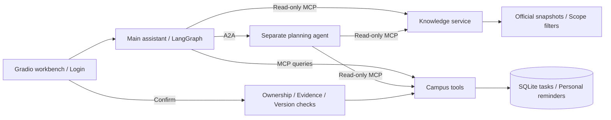

# CampusPilot | Student onboarding assistant

English · [简体中文](README.md)

CampusPilot is an agent workbench for student onboarding questions, checklists, and personal reminders. The main assistant queries knowledge and campus tools through MCP and delegates planning to a separate agent through A2A. Personal tasks and calendar entries are saved after user confirmation.

The current version is **v0.3.1 with the 2026-10-18 pilot-readiness update**. Its default knowledge base uses public Wuhan University of Technology (WHUT) materials for the 2026 undergraduate cohort, captured on 2026-10-11. It contains 4 reviewed official sources and 11 checklist templates. This personal development project does not connect to the university's personal business systems.

## Features

- Answer onboarding questions with evidence filtered by school, student type, cohort, campus, and date; retain source URLs, snapshot hashes, and version notes.
- Build checklists and ask for missing conditions such as the financial aid route; keep unverified office hours, processing times, and registration locations unknown.
- Save explicitly timed personal reminders, check time zones, deadlines, and calendar conflicts, and export ICS files.
- Recheck evidence, ownership, and versions when saving; use SQLite transactions and idempotency keys to prevent duplicate writes.
- Provide invite-only accounts, revocable login sessions, account isolation, submission limits, feedback, and local statistics.
- Record cancellation and interrupted work, and keep question answering available when the planning service is down.

The assistant does not invent university appointment slots. Expired onboarding dates prompt the user to confirm arrangements with the university. Personal reminders are neither university appointments nor a guaranteed notification service.

## 2026-10-18 update

- Personal task queries read the authenticated user's MCP data directly; single-task drafts require preview and confirmation, with rejection and stale-draft handling.
- A main chat and explanatory sidebar keep history, tasks, sources, and feedback in expandable panels. Enter sends; Shift+Enter adds a line.
- Operations separate account categories, fixture/live mode, turn status, saved writes, manual task review, and per-call token usage. Tools cover cost estimates, offline queue simulation, stopped-service SQLite backup, and restore into a new directory.
- Read-only timetable and housing contracts validate source timestamps, requested ranges, and record ownership. They default to not connected; no university authorization or live personal-data integration is claimed.
- Local HTTPS tunnel start/stop scripts and an explicit allowed public origin support invite-only sharing. Access depends on the operator's computer and a temporary tunnel; no permanent public demo URL is advertised.

The rollout plan starts with five interviews, then targets 5 → 15–20 → 50–70 cumulative participants. These are goals, not adoption or tested throughput. See the [pilot kit](docs/pilot/README.md), [school contracts](docs/SCHOOL_INTEGRATION.md), and [project report](docs/RESUME_PROJECT.md).

## Stack and architecture

| Layer | Implementation |
| --- | --- |
| Runtime | Python 3.11/3.12, uv |
| Workbench and API | Gradio, FastAPI, Uvicorn |
| Agents and protocols | LangGraph, MCP, A2A SDK, native tool_calls |
| Default retrieval | Weighted character TF-IDF and BM25, parent/child chunks, filtering before retrieval |
| Storage and calendar | SQLite, icalendar / ICS |
| Optional branch | Milvus and BGE; not validated |



The main application uses port 8010 by default. Planning, knowledge, and tool services use 8020, 8030, and 8040. Internal services bind to loopback and use private service credentials.

## Quickstart: local fixture demo

Install Git, uv, and Python 3.11. On Windows, run the commands in PowerShell 7 (`pwsh`). The project supports Python `>=3.11,<3.13`; these commands use the 3.11 environment documented in the validation records. Fixture mode needs no model API key.

```powershell
git clone https://github.com/haihaihai112/campus-pilot.git
cd campus-pilot
uv sync --frozen --python 3.11
uv run --no-sync campus all --fixture
```

Open the [workbench](http://127.0.0.1:8010/ui/) or [API documentation](http://127.0.0.1:8010/docs). Stop services with Ctrl+C. To avoid port conflicts, use `uv run --no-sync campus all --fixture --base-port 8110`; the four ports become 8110, 8120, 8130, and 8140.

This mode has no login and uses a shared demo identity for local demonstrations. Fixture mode replaces model decisions; retrieval, storage, MCP/A2A transport, and confirmation run normally. Its results do not measure live model accuracy.

The default profile is `CAMPUS_DATA_PROFILE=whut-2026`, with data in `runtime-whut-2026/`. The reference date is today's date in Asia/Shanghai. Set `DEMO_DATE=2026-09-05` only for explicit historical replay. September onboarding deadlines that have passed remain expired.

### Walkthrough

The workbench and fixture examples use Chinese prompts:

1. Ask `2026级本科生报到需要带哪些材料？` and inspect the official sources and their scope.
2. Start a new conversation with `帮我规划入学清单`; answer the clarification with `我是2026级本科生，还没缴费，安排报到入住`.
3. Inspect the checklist and unknown items. No personal tasks or calendar entries exist before confirmation.
4. Confirm twice and check that the second confirmation creates no duplicates.
5. For a calendar entry, explicitly provide the start and end of a personal reminder, save it, and export ICS. Untimed checklist items become tasks only.

## Invite-only accounts and live models

Create a configuration and account to use login isolation. These are PowerShell 7 commands:

```powershell
uv run --no-sync campus init-pilot
$env:CAMPUS_ENV_FILE = Join-Path (Get-Location) '.env.pilot'
uv run --no-sync campus accounts add student01
pwsh -NoProfile -File ./scripts/start-pilot.ps1 -Fixture
```

Open the [login page](http://127.0.0.1:8010/login). Accounts are created individually through the CLI; there is no self-registration. Passwords are entered interactively and require at least 12 characters. `init-pilot` generates three private service credentials and refuses to overwrite an existing `.env.pilot`.

In Bash, run `export CAMPUS_ENV_FILE="$PWD/.env.pilot"` after initialization, create the account, and start with `uv run --no-sync campus all --fixture`.

To use a live model, configure `.env.pilot`:

```dotenv
MODEL_MODE=live
LLM_API_KEY=your-provider-key
LLM_MODEL=your-tool-calling-model
LLM_BASE_URL=https://your-provider.example/v1
```

Use a model supported by the configured provider and endpoint. The model must support native `tool_calls`. Run `pwsh -NoProfile -File ./scripts/start-pilot.ps1`, or set `CAMPUS_ENV_FILE` and run `uv run --no-sync campus all`. Live mode consumes the configured provider's quota. Keep configuration files and credentials out of Git.

The generated local HTTP configuration uses `COOKIE_SECURE=false`. Remote invite-only trials require HTTPS and `COOKIE_SECURE=true`; see [pilot deployment](docs/PILOT.md) for deployment and backup requirements. For temporary local sharing, run `pwsh -NoProfile -File ./scripts/start-https.ps1` after configuring the same `.env.pilot`, invite accounts, and model. Stop with `pwsh -NoProfile -File ./scripts/stop-https.ps1`; see [HTTPS conditions](docs/pilot/HTTPS_LOCAL.md). Account management and statistics must use the same configuration:

```powershell
uv run --no-sync campus accounts list
uv run --no-sync campus accounts disable student01
uv run --no-sync campus stats
```

## Checks and validation records

The 2026-10-18 publication copy reruns the existing offline regressions using fixture mode, isolated configuration, and new runtime directories; actual results are recorded in [publication checks](docs/PUBLICATION.md). Historical migration checks, a live-model developer regression, and temporary HTTPS checks remain separate evidence, not model accuracy or student adoption.

```powershell
uv run --no-sync pytest -q --junitxml=reports/tests-local.xml
uv run --no-sync ruff check src tests scripts
uv run --no-sync python scripts/verify_pilot.py --runtime ./runtime-smoke-new --output ./reports/smoke-new.json --data-profile whut-2026 --reference-date 2026-10-11
```

The smoke script starts four local processes with fixture mode and two test accounts. Both output paths must be new. It checks questions, A2A clarification, idempotent confirmation, and account isolation without paid model calls.

[Publication checks](docs/PUBLICATION.md) on 2026-10-14 passed 104 pytest tests and Ruff. The [new four-process smoke record](reports/publication-smoke.json) uses that day's reference date, official data, and fixture mode to check two-account isolation and confirmed saves, with 0 paid model calls. It does not measure real user experience or model quality.

The v0.3.1 [historical validation summary](reports/whut-verification-v0.3.1-2026-10-11.json) records 104 passing tests: 75 synthetic baseline regressions and 29 tests for the official data profile. These are program and protocol tests, not 104 live model questions. The [two-account smoke record](reports/whut-pilot-smoke-v0.3.1-2026-10-11.json) and [single-command launch record](reports/whut-native-launch-v0.3.1-2026-10-11.json) retain detailed results.

Rebuild the data with `uv run --no-sync python scripts/build_whut_data.py`. The script reads reviewed local snapshots; it does not fetch policy updates.

## Scope and limitations

- Only 4 sources for the 2026 undergraduate cohort were reviewed. Tuition and transport images were not transcribed. Graduate policies, other cohorts, personal fees, dorm assignments, and registration office hours remain unverified.
- The current WHUT version has a recorded live DeepSeek developer regression, but no independent model-quality evaluation. Retrieval metrics and live traces from the older synthetic knowledge base do not describe this version.
- Milvus/BGE, live map and weather calls, and Docker container execution remain unverified. A Compose syntax check does not establish that containers ran.
- No external calendar provider is bound. Timetables and housing have read-only contracts but no authorized live adapter; university notifications remain a placeholder. Payment, academic administration, and aid approval are not performed.
- A temporary local HTTPS invitation entry was verified. There is no fixed cloud deployment, verified student adoption count, or load test for the 50–70 participant target. Queues and concurrency controls are local to one process; do not simply add workers.
- Account isolation is enforced at the main application boundary. MCP/A2A services are trusted internal services, not independent authorization services for multiple tenants.

## Documentation

- [Sources and data model](docs/WHUT_DATA.md): source discrepancies, scope, checklist and reminder semantics.
- [Pilot deployment](docs/PILOT.md): accounts, HTTPS, limits, recovery, and data volumes.
- [Interfaces](docs/INTERFACES.md) and [external tools](docs/EXTERNAL_TOOLS.md): protocols, API, and adapter boundaries.
- [Official-data migration report](docs/WHUT_MIGRATION_2026-10-11.md): historical work, original evidence, and validation scope.
- [Baseline manifest](docs/BASELINE_MANIFEST.json): copy provenance and original file hashes.

## Attribution and license

This project derives from the original `campus-onboarding-agent`, retaining and adapting retrieval, campus tools, MCP/A2A, and confirmation flows. The baseline manifest records copy provenance and original hashes. Historical synthetic evaluations belong to that baseline and do not establish the current official-data version's quality.

The repository currently has no LICENSE file or declared repository-wide open-source license. Public availability does not automatically grant rights to use, modify, or redistribute the code. Third-party dependencies and official materials retain their own licenses and terms.
