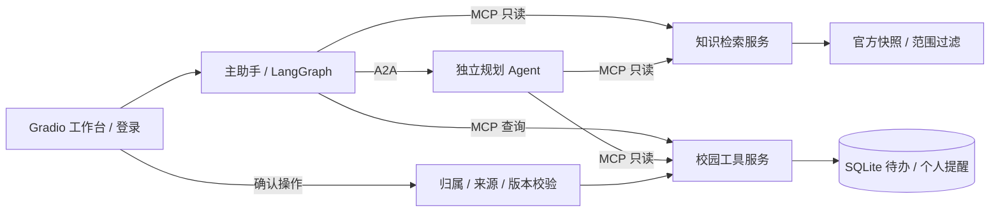

# CampusPilot | 新生入学事务助手

[English](README.en.md) · 简体中文

CampusPilot 是面向新生入学咨询、办理清单和个人提醒的 Agent 工作台。主助手通过 MCP 查询知识与校园工具，通过 A2A 委派独立规划 Agent；用户确认后，系统才保存个人待办或日历记录。

当前版本为 **v0.3.1**。默认知识库采用武汉理工大学 2026 级本科公开资料的 2026-10-11 快照，实际入库 4 份官方来源、覆盖 11 类办理模板。这是个人开发项目，未接入学校个人业务系统。

## 能做什么

- 回答入学资料问题，按学校、学生类型、入学年份、校区和日期过滤证据，展示来源 URL、快照哈希与版本说明。
- 根据条件生成办理清单，追问资助路径等缺失信息；未知窗口、办理时长和报到地点保持未知。
- 将用户明确指定起止时间的事项保存为个人提醒，检查时区、截止节点和已有日历冲突，导出 ICS。
- 在确认保存时重新核验来源、归属与版本，通过 SQLite 事务和幂等键防止重复写入。
- 提供邀请账号、可撤销登录、个人会话与事项隔离、提交限额、反馈和本地统计。
- 保留规划服务故障降级、任务取消和重启中断记录，避免静默重跑写入。

学校未公布的时段不会被编造为预约。过期入学节点会提示联系学校核实补办，个人提醒也不代表校方预约或主动通知服务。

## 技术与架构

| 层 | 实现 |
| --- | --- |
| 运行环境 | Python 3.11/3.12、uv |
| 工作台与 API | Gradio、FastAPI、Uvicorn |
| Agent 与协议 | LangGraph、MCP、A2A SDK、原生 tool_calls |
| 默认检索 | 字符 TF-IDF 与 BM25 加权融合、父子分块、检索前范围过滤 |
| 存储与日历 | SQLite、icalendar / ICS |
| 可选分支 | Milvus、BGE；尚未实测 |



主应用默认使用 8010 端口，规划、知识和工具服务分别使用 8020、8030、8040。内部服务绑定本地回环地址，使用私有服务凭据。

## 快速启动：本地 fixture 演示

准备 Git、uv 和 Python 3.11；Windows 请使用 PowerShell 7（`pwsh`）执行本文命令。项目支持 Python `>=3.11,<3.13`，下面使用验证记录中的 3.11 环境。fixture 不需要模型密钥。

```powershell
git clone https://github.com/haihaihai112/campus-pilot.git
cd campus-pilot
uv sync --frozen --python 3.11
uv run --no-sync campus all --fixture
```

打开[工作台](http://127.0.0.1:8010/ui/)或 [API 文档](http://127.0.0.1:8010/docs)。按 Ctrl+C 停止服务。端口冲突时可用 `uv run --no-sync campus all --fixture --base-port 8110`，四个端口随之变为 8110、8120、8130、8140。

此模式不登录，使用一个共享演示身份，仅适合本机展示。fixture 替代模型决策；检索、数据库、MCP/A2A 协议和确认保存真实执行，不能用其结果声明真实模型准确率。

默认 `CAMPUS_DATA_PROFILE=whut-2026`，运行数据保存在 `runtime-whut-2026/`，参考日期为当天北京时间。`DEMO_DATE=2026-09-05` 仅用于显式历史重放；当前日期已过的 9 月入学节点会显示过期提示。

### 演示流程

1. 查询“2026级本科生报到需要带哪些材料？”，查看原文来源和适用范围。
2. 新开会话，输入“帮我规划入学清单”，按追问补充“我是2026级本科生，还没缴费，安排报到入住”。
3. 查看清单和未知项。确认前不会创建个人待办或日历。
4. 确认保存并重复确认，检查待办没有重复创建。
5. 要生成日历，明确指定个人提醒的起止时间，再保存并导出 ICS。没有具体时间的清单只创建待办。

## 邀请账号与在线模型

需要登录隔离时，先创建配置与账号。以下为 PowerShell 7 命令：

```powershell
uv run --no-sync campus init-pilot
$env:CAMPUS_ENV_FILE = Join-Path (Get-Location) '.env.pilot'
uv run --no-sync campus accounts add student01
./scripts/start-pilot.ps1 -Fixture
```

打开[登录页](http://127.0.0.1:8010/login)。账号通过命令逐个创建，不开放自助注册；密码由交互输入，至少 12 个字符。`init-pilot` 生成三份独立私有服务凭据，已有 `.env.pilot` 时拒绝覆盖。

若使用 Bash，可在初始化后运行 `export CAMPUS_ENV_FILE="$PWD/.env.pilot"`，再创建账号并执行 `uv run --no-sync campus all --fixture`。

切换在线模型时，在 `.env.pilot` 配置：

```dotenv
MODEL_MODE=live
LLM_API_KEY=your-provider-key
LLM_MODEL=your-tool-calling-model
LLM_BASE_URL=https://your-provider.example/v1
```

模型和地址必须属于同一可用服务商，模型需要支持原生 `tool_calls`。然后运行 `./scripts/start-pilot.ps1`，或在设置 `CAMPUS_ENV_FILE` 后运行 `uv run --no-sync campus all`。在线模式会消耗所配置服务的额度；勿提交配置文件或凭据。

本地 HTTP 的初始化配置使用 `COOKIE_SECURE=false`。远程邀请体验需要 HTTPS 与 `COOKIE_SECURE=true`，具体部署和备份要求见[邀请体验部署](docs/PILOT.md)。统计和账号管理命令应使用同一配置文件：

```powershell
uv run --no-sync campus accounts list
uv run --no-sync campus accounts disable student01
uv run --no-sync campus stats
```

## 检查与验证记录

```powershell
uv run --no-sync pytest -q --junitxml=reports/tests-local.xml
uv run --no-sync ruff check src tests scripts
uv run --no-sync python scripts/verify_pilot.py --runtime ./runtime-smoke-new --output ./reports/smoke-new.json --data-profile whut-2026 --reference-date 2026-10-11
```

冒烟脚本自行启动四个本地进程，使用 fixture 和两个测试账号；运行目录与输出必须是新路径。它验证问答、A2A 追问、确认幂等和账号隔离，不调用计费模型。

2026-10-14 [发布前复核](docs/PUBLICATION.md)：104 项 pytest 与 Ruff 通过；[本次四进程冒烟](reports/publication-smoke.json)使用当天日期、官方资料和 fixture，验证双账号隔离与确认保存，计费模型调用为 0。该记录不代表真实用户体验或模型质量。

v0.3.1 的[历史验证摘要](reports/whut-verification-v0.3.1-2026-10-11.json)记录 104 项测试通过，其中 75 项为合成基线回归、29 项为真实资料专项。它们是程序与协议测试，不是 104 次真实模型问答。[双账号冒烟记录](reports/whut-pilot-smoke-v0.3.1-2026-10-11.json)和[单命令启动记录](reports/whut-native-launch-v0.3.1-2026-10-11.json)保留具体结果。

资料重建可运行 `uv run --no-sync python scripts/build_whut_data.py`。脚本只读取经过审核的本地快照，不自动更新学校政策。

## 范围与限制

- 仅核对 2026 级本科的 4 份来源。专业学费和交通图片未转录，研究生、其他年份、个人金额、宿舍分配和报到窗口未验证。
- 当前 WHUT 版本未完成真实模型质量评测。更早合成知识库的检索指标或在线模型轨迹不代表此版本效果。
- Milvus/BGE、地图天气真实调用和 Docker 容器运行尚未验证；Compose 配置解析记录不等于容器已运行。
- 外部日历未绑定平台，学校通知和课表只有接口预留；不执行缴费、教务或资助审批。
- 尚无公网生产部署、真实用户规模或 50 至 100 人负载实测。队列和并发控制限于单进程，不应直接增加多个 worker。
- 账号隔离在主应用边界执行，MCP/A2A 是受信任内部服务，不是独立的多租户授权服务。

## 文档导航

- [资料来源与数据模型](docs/WHUT_DATA.md)：来源差异、有效范围、清单与提醒语义。
- [邀请体验部署](docs/PILOT.md)：账号、HTTPS、限额、恢复与数据卷。
- [接口说明](docs/INTERFACES.md)与[外部工具说明](docs/EXTERNAL_TOOLS.md)：协议、API 和适配边界。
- [真实资料迁移报告](docs/WHUT_MIGRATION_2026-10-11.md)：历史过程、原始证据与验证口径。
- [基线清单](docs/BASELINE_MANIFEST.json)：复制来源与修改前文件哈希。

## 来源与许可

项目以原 `campus-onboarding-agent` 为基线，保留并改造了检索、校园工具、MCP/A2A 和确认保存流程。复制来源及原文件哈希保存在上述基线清单中；历史合成评测归属于原基线，不用于当前资料版的效果声明。

仓库目前未附带 LICENSE，也未声明统一的开源许可。公开代码不自动授予使用、修改或再分发权；第三方依赖和官方资料仍适用各自的许可与使用条款。
