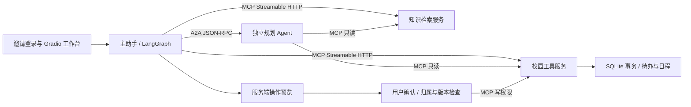

# CampusPilot 简历项目报告

更新：2026-10-18。适用方向：AI应用开发、Agent开发；未按具体岗位JD定制。源码依据为本地提交 `f0f0ba6`，数字依据为下文列出的验证记录。

## 可直接用于简历的项目经历

CampusPilot｜基于 MCP / A2A 的校园事务双 Agent 助手

技术栈：Python 3.11、LangGraph、FastAPI、DeepSeek、MCP、A2A、RAG、Gradio、SQLite WAL。

面向高校新生的入学事务助手，基于官方公开资料提供政策咨询、办理清单规划和个人事项管理，支持从条件追问、计划预览到确认保存的完整流程。

- 构建主助手与独立规划Agent的协作架构，以LangGraph编排原生工具调用，通过MCP接入知识与校园工具，通过A2A实现规划任务的追问、继续、取消和结果交付。
- 整理4份官方资料快照与11类办理模板，采用父子分块、字符TF-IDF与BM25加权融合检索，按年份、学生类型和校区等条件过滤证据，输出可追溯来源并提示资料缺口及过期节点。
- 实现邀请登录、服务端身份注入及个人数据隔离，将模型提出操作与实际写入分开；结合来源重校验、版本校验、SQLite事务和幂等键，验证未确认不写入、重复确认不重复创建。
- 接入真实DeepSeek模型并交付HTTPS邀请体验版本，补齐排队、账号小时限流与逐调用Token记录；完成162项自动化回归及跨进程协议验证，覆盖账号隔离、确认写入、提醒冲突和重启恢复。

以上版本不填未经核定的使用人数、正确率、效率提升或并发能力。项目时间、求职者身份和个人分工由本人按实际经历填写，不将既有原型描述为从零独立完成。

## 项目定位与当前交付

项目从已有Agent原型迭代而来，当前侧重校园业务适配、真实资料迁移、执行安全与小规模试用准备。默认资料范围为武汉理工大学2026级普通本科、2026-10-11公开网页快照；项目独立开发，尚未接入校方个人业务系统。

用户可以查询报到材料和费用规则、补充规划条件、预览办理清单，并在确认后保存待办。单条个人待办也有独立预览与确认流程；明确指定起止时间时可以创建个人日程并导出ICS。个人日程不代表校方预约，也不具备主动推送通知能力。

已提供邀请登录的网页入口，运行真实DeepSeek配置。对外访问采用本机主站加免费SSH / HTTPS隧道；这是临时体验部署，依赖电脑开机、网络和隧道地址。已遇到免费服务换址、旧地址返回502的情况，不能描述为稳定云部署或生产级高可用。

## 架构与实现证据

主站8010、规划8020、知识MCP 8030、校园MCP 8040为四个独立服务。主站单进程，当前均监听回环地址，隧道只转发主站。MCP和A2A使用各自Python SDK，包含实际跨进程连接、工具发现及调用、Agent Card与任务状态交互。

| 模块 | 已实现行为 | 代码位置 |
|---|---|---|
| 主助手与工具编排 | LangGraph状态图、原生tool_calls、独立规划委派、操作预览 | [assistant.py](../src/campus_agent/assistant.py) |
| MCP / A2A客户端 | 工具发现与调用、Agent发现、任务继续、轮询及取消 | [protocols.py](../src/campus_agent/protocols.py) |
| 规划Agent | 条件追问、结构化计划、未知及过期事项说明 | [planner.py](../src/campus_agent/planner.py) |
| 知识检索 | 父子分块检索、TF-IDF / BM25加权、父块聚合 | [retrievers.py](../src/campus_agent/baseline/retrievers.py) |
| 登录与隔离 | 密码哈希、可撤销登录、账号归属、跨站写入拦截 | [access.py](../src/campus_agent/access.py) |
| 校园工具 | MCP读写权限、计划应用、个人待办操作 | [mcp_servers.py](../src/campus_agent/mcp_servers.py) |
| 运营证据 | 账号分类、工作流结果、耗时与模型用量统计 | [metrics.py](../src/campus_agent/metrics.py) |
| 学校扩展接口 | 课表与宿舍只读契约、身份绑定检查、上游错误处理 | [school.py](../src/campus_agent/integrations/school.py) |

## 值得在面试展开的技术点

| 问题 | 项目采用的做法 | 能说明的结果 |
|---|---|---|
| 简单咨询与规划任务的生命周期不同 | 主助手负责交互，独立Agent承接需追问和交付计划的任务，A2A传递状态 | 可展示同一任务补充条件后继续、取消和接收结构化结果；未声称双Agent必然提高准确率 |
| 官方资料缺少个人窗口、地点和办理时长 | 规则清单与个人提醒分开，未知字段保留未知，过期节点提示核实补办 | 避免把资料缺口填成校方日程；只有用户明确时间的个人事项才生成提醒 |
| 模型工具调用可能带来错误写入 | 模型提出操作，服务端保存快照，用户确认后再做来源、归属与版本检查 | 未确认和拒绝操作均不写入；相同操作重复确认返回既有结果 |
| 多账号使用时不能依赖提示词隔离 | 服务端登录身份贯穿REST、Gradio、MCP参数和规划上下文 | 模型参数不能替换本人身份；外账号查询、确认他人记录被拒绝 |
| 控制工具查询的模型开销 | 明确的待办查询直接调用本人MCP数据，仍记录工具轨迹 | 网页待办查询验证为1次MCP、0次模型调用；不将该结果扩展为所有查询零成本 |
| 真实使用与程序测试容易混在一起 | 分别登记模型模式、账号用途、轮次状态、写入结果、人工复核与反馈 | 账号数、轮次完成、用户任务完成和回答正确率分别统计，不相互替代 |

检索实现采用字符TF-IDF和BM25的加权融合，不能写成RRF、已部署语义向量库或已验证的重排模型。Milvus / BGE属于可选分支，不作为当前线上技术成果。

## 当前可引用的数字与限制

| 数字或结果 | 记录依据 | 简历使用口径 |
|---|---|---|
| 4份官方资料、11类模板 | [资料说明](WHUT_DATA.md)、README及入库数据 | 已整理的知识与业务范围，不是11个校方接口 |
| 162项测试通过，0失败、0错误、0跳过 | 本机 `reports/tests-https-20261018.xml`，时间2026-10-18 | 程序和协议回归结果，不是模型回答准确率 |
| 真实模型回归6次调用，报告29,038 Token | 本机 `reports/live-fix-check-20261018.json`；[反馈修复说明](pilot/FIX_REVIEW_2026-10-18.md) | 一次开发者回归的调用量，不是项目总用量或用户规模 |
| 请求别名deepseek-chat，实际响应deepseek-flash | 上述逐调用记录 | 简历写“接入DeepSeek”，计费按实际响应模型和账单核对 |
| HTTPS登录、跨账号404、未登录401、跨站写403、Gradio SSE待办查询通过 | [HTTPS验证说明](pilot/HTTPS_LOCAL.md)及被忽略的本机验证记录 | 已验证远程邀请入口与相关安全行为，不代表长期在线 |
| 新增26个独立测试账号，26个密码哈希及分类核对、2个公网登录抽查通过 | 本机对应批次 `creation-report.json` | 试用账号准备，不写“26名学生已使用” |
| 每账号20次提交/小时、2个待处理；全局4个处理中、32个待处理 | Settings及主助手的限制机制 | 已配置的限制，不是4人或70人的已测吞吐能力 |

四进程fixture冒烟记录为 `reports/verify-https-20261018-161422.json`，覆盖咨询、追问、确认前无待办、外账号拒绝、重复确认和个人事项隔离，模型调用0。真实模型开发者回归与此离线测试分别统计。

已有测试账号、脚本人设和开发者操作不作为真实学生采用。当前登记记录未提供已核定的真实学生使用人数；26套账号可能被用于后续测试，需结合实际参与、真实请求及反馈另行确认。50—70人是计划目标，30条语义评测案例仍待独立审核。

原始报告、账号、密码、会话、SQLite及截图仅保存在本机被忽略的目录，本文只引用文件名和匿名汇总，不将原文提交Git。

## 面试回答参考

问：这个项目真实使用了吗，有多少人？

“项目已接入真实DeepSeek，并做出了邀请登录的HTTPS体验版本，完成了开发者端到端验证。我准备了26个独立测试账号交给后续测试使用，但账号准备数和实际使用人数分开记录，目前不报未经核实的学生人数。后续按真实请求、实际完成的事项和自愿反馈整理使用结果。”

问：你具体实现了什么？

“我基于既有Agent原型做校园业务适配，把主助手、独立规划Agent和两个MCP服务连起来。咨询检索官方资料，规划缺条件时追问，生成的操作先预览，确认后才保存。个人身份由服务端注入，写入再检查来源、版本和归属，用事务和幂等键处理重复确认，并补齐真实模型日志、隔离测试与远程体验入口。”

问：为什么还没有直接扩到70人？

“70人是分散一周的累计目标，需要先确认当前需求。当前有排队和小时限流，但临时隧道会换址，日/周Token额度与总费用闸门也还没实现。我会先解决稳定访问和费用控制，再根据小批测试结果扩邀，避免把配置值当容量测试结果。”

## 尚未完成，不能写成成果的部分

- 学校课表与宿舍仅完成只读接口和适配器契约，默认返回未接通；没有校方授权、真实数据适配、SSO或正式身份绑定。
- 云主机、固定地址、自动重连和长期运行保障尚未落地；当前是本机临时隧道。
- 日/周Token硬额度及总费用封顶尚未实现；小时次数限制不等同费用封顶。
- 没有可复用的真实问答准确率、节省时间比例、70人容量或持续活跃数据。
- 知识图谱、Redis、用户偏好长期记忆、主动通知与待办删除未作为当前交付实现。

## 复现与证据

- 公开源码与复现步骤见[项目入口](../README.md)，本次发布副本验证见[发布检查](PUBLICATION.md)。
- 试用工作包、学校契约与临时访问条件分别见 [pilot](pilot/README.md)、[学校接口](SCHOOL_INTEGRATION.md)、[HTTPS](pilot/HTTPS_LOCAL.md)。
- 上述真实模型和公网摘要为实现工作区的历史记录；原始对话、账号、私有运行目录和凭据不随公开仓库发布。本轮发布不重新调用付费模型。
