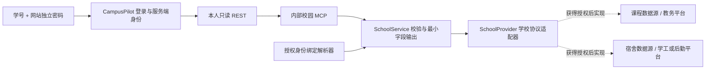

# 学校课程与宿舍只读接入约定

此文为对应阶段的历史记录；后续实现状态与本次发布验证以 README 和 docs/PUBLICATION.md 为准。
状态：CampusPilot 侧的标准化模型、本人查询 REST、内部 MCP、适配器契约和错误处理已准备；尚无学校接口、授权凭证、正式身份绑定或真实学生数据。没有启用网络适配器或文件导入，不收集学校密码。通知接口仍为原占位。

## 与学校协商的架构



学校可提供授权 API 或约定的数据导出，后续分别实现适配器。课程与宿舍可能属于不同系统，不假定一个教务接口包含全部数据。当前没有绕过统一认证、抓取登录页面或代学生登录的代码。

网站账号名已有3—40位字母数字支持，可以使用学号；密码由组织者单独分发，至少12位。内部仍使用随机 user_id 隔离记录，避免将学号变成公开主键。网站密码与校方密码分离。学号登录本身不证明学校身份，接入时由组织者核实的名单或学校 SSO 建立并撤销正式绑定；本轮尚未实现 SSO、批量账号导入、密码重置或绑定管理后台。

## 已实现的本人查询接口

沿用邀请登录 Cookie 或既有登录令牌；REST 不接收 user_id、student_id 或 subject_id 作为查询身份。额外同名查询参数不能覆盖服务端身份。内部MCP只在私网/回环地址提供，需要现有私有凭据。

| REST GET | 内部 MCP | 参数 |
|---|---|---|
| /v1/school/timetable | get_timetable | start_date、end_date，YYYY-MM-DD，含首尾1—31天 |
| /v1/school/housing | get_dorm_assignment | 无 |
| /v1/integrations | get_integration_status | 无；包含 school_timetable / school_housing 状态 |

登录后的 `/openapi.json`、`/docs` 描述课程和宿舍响应模型。未登录返回401，日期格式错误由 REST 返回422；格式合法但反向或超过31天的范围返回结构化 invalid_arguments。个人响应使用 private, no-store，未增加任何校方写接口。

未接通的响应：

```json
{"ok": false, "data": null, "error": {"code": "not_connected", "message": "课程与宿舍接口已预留，尚未接入学校授权数据源。"}}
```

接通后成功响应 `data` 包含 school_id、source、read_only=true，以及 entries 或 assignment。只有具备来源的成功响应才允许 entries=[] 或 assignment=null，不能以空结果代替未接通。

## 学校适配器契约

实现位置：`src/campus_agent/integrations/school.py`。

| 契约 | 字段/行为 |
|---|---|
| StudentBinding（仅服务端） | user_id、school_id、subject_id、authorization_ref；授权引用是审计标识，不是访问令牌 |
| SchoolProvider.list_timetable | 接受已绑定身份与首尾日期；返回 TimetableSnapshot |
| SchoolProvider.get_housing | 接受已绑定身份；返回 HousingSnapshot |
| SchoolProvider.search_notices | 原公开通知扩展契约；本轮不实现 |
| SchoolSource | system、record_version、retrieved_at、data_as_of；两个时间须带时区 |
| TimetableEntry | course_id、title、start、end、location、source；时间带时区且结束晚于开始 |
| DormAssignment | campus、building、room、可选bed及valid_from；不接受室友名单、联系电话或额外字段 |

适配器内部结果须回传 school_id、subject_id，与服务端绑定匹配；不匹配拒绝返回数据。对外剔除 subject_id，绑定和 authorization_ref 不出现在成功响应。课表最多500条，按北京时间核对查询范围。上游读取限制10秒，不自动重试；失败不回显响应原文、地址、绑定或凭证。`configured` 只表示服务依赖齐备，不代表已验证连通或数据持续有效。

`SchoolService(provider, resolve_binding)` 提供学校协议与身份解析的注入接口；运行中的校园 MCP 当前只构造无适配器的默认服务。正式接入时，在这个服务内部装配经审核的 provider 和绑定解析器，不能增加让浏览器/模型随意设置 provider 或绑定的公开接口。课程与宿舍可组合两个只读上游适配器。完成校方字段映射、鉴权和撤销测试后，才启用运行时装配。

主助手现有个人平台未绑定拦截继续保留，宿舍工具没有加入模型可发现清单。当前新增 REST 查询不调用模型。后续优先在本地直接展示课表与宿舍，单独确认数据使用范围后再决定是否向外部模型提供必要片段；不将整个学生库送入知识库。

## 与学校说明时需要确认

- 提供课程和宿舍数据的负责部门、接口说明、测试环境、授权范围和可撤销方式。
- 学生身份是学校 SSO subject、学号还是脱敏标识；如何可靠映射到网站账号。
- 课程需确认学期、教学周/单双周、调停课、补课、节次表、校区和教室。标准契约使用已经解析的具体起止时间；适配器负责校方课表格式转换。
- 宿舍只申请本人校区、楼栋、房间和必要床位，不申请其他学生、室友或完整住宿名册。
- 数据更新时点、版本号、变更/撤销通知、保存期限、测试账号及学校要求的访问日志；不能用抓取时刻代替校方更新时间。

校方完成授权及提供文档后，下一阶段才实现真实适配器、绑定管理和校方测试环境端到端验证。本轮自动化使用测试替身，不是学校接入成功的证据。

## 本轮验证

- 全量157项回归通过，Ruff与diff检查通过；学校模块15项测试，连同MCP协议回归共34项通过。
- 覆盖默认未连接、账号为学号、REST登录与身份注入、上游归属校验、查询范围、时区、正常空结果、异常脱敏及OpenAPI契约。测试不调用真实模型或校方系统。
- 服务重启后原记录哈希一致，四服务健康，未登录学校查询返回401；原运行模式仍为live，测试另用fixture目录。
- 完成一次只读静态审查，未发现有证据支持的新缺陷；这不能代替校方接入验收。

本机原始证据位于被Git忽略的 `reports/school-contracts-unit-20261018.xml`、`reports/school-contracts-protocol-20261018.xml`、`reports/school-contracts-full-20261018.xml`、`reports/school-contracts-runtime-20261018.json`。本轮无真实模型请求、无采购、无公网部署。
